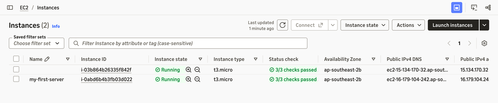
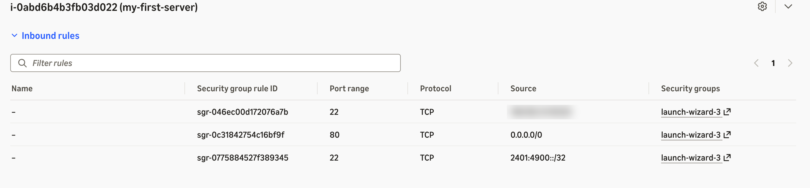
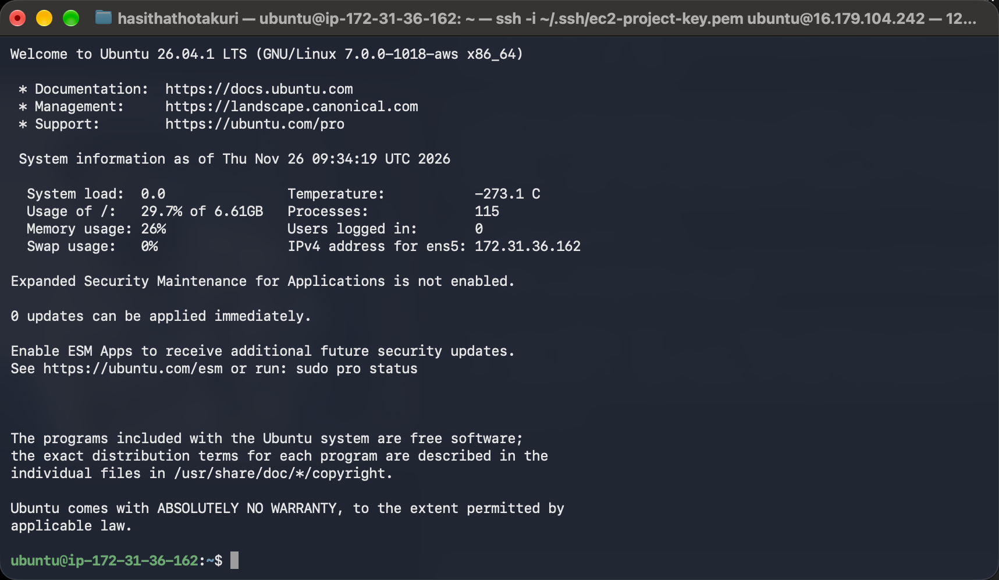
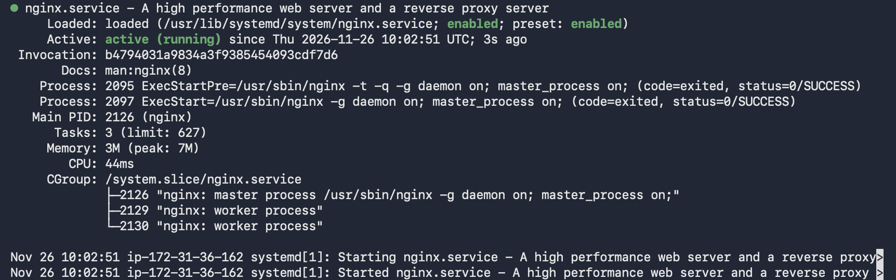
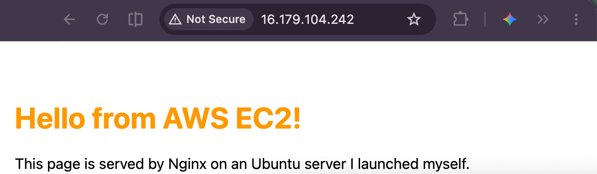

# Deploy a Static Website on AWS EC2 (Ubuntu + Nginx)

A beginner DevOps project: launch a Linux server on AWS EC2, connect to it over SSH from a Mac, install the Nginx web server, and serve a static HTML page on the instance's public IP address.

**Status:** Complete (core requirements)
**Completed:** November 2026

---

## Architecture

```
 Browser (HTTP :80)  ─┐
                      ├──►  Security Group  ──►  EC2 instance (t3.micro)  ──►  Nginx  ──►  /var/www/html/index.html
 Terminal (SSH :22)  ─┘     (firewall rules)     Ubuntu Server 26.04 LTS
```

| Item | Value |
|---|---|
| Cloud provider | AWS (Free plan account) |
| Region | `ap-southeast-2` (Sydney) |
| AMI | Ubuntu Server 26.04 LTS |
| Instance type | `t3.micro` (see note below) |
| Network | Default VPC and default subnet, public IPv4 enabled |
| Web server | Nginx 1.28.3 |
| Local machine | MacBook (macOS Terminal, built-in `ssh` and `scp`) |

> **Note on `t2.micro`:** The project brief suggests `t2.micro`. On AWS accounts created after July 2025, the Free Tier uses a credit-based plan and `t2.micro` is not on the eligible list, so I used `t3.micro`, which the console marked as *Free tier eligible*. It does the same job for this project.

---

## Requirements checklist

- [x] AWS account created
- [x] Explored the AWS Management Console
- [x] Launched an EC2 instance (Ubuntu AMI, small free-tier-eligible type, default VPC and subnet)
- [x] Security group allowing ports 22 (SSH) and 80 (HTTP)
- [x] New key pair created for SSH access
- [x] Public IP assigned
- [x] Connected over SSH with the private key
- [x] Updated system packages and installed Nginx
- [x] Created a simple HTML page
- [x] Deployed the page and accessed it via the public IP

---

## Step-by-step

### 1. Account and billing safety

1. Created an AWS account (Free plan, credit-based).
2. Opened **Billing and Cost Management** and checked the **Credits** page for balance and expiry.
3. Created a monthly cost budget in **AWS Budgets** with an email alert.

### 2. Launch the EC2 instance

In **EC2 > Instances > Launch instances**:

| Setting | Value |
|---|---|
| Name | `my-first-server` |
| AMI | Ubuntu Server 26.04 LTS |
| Instance type | `t3.micro` |
| Key pair | New RSA key pair `ec2-project-key` (`.pem` format) |
| Network | Default VPC, default subnet, auto-assign public IP **enabled** |
| Storage | Default 8 GiB |

### 3. Security group (firewall)

| Type | Port | Protocol | Source | Purpose |
|---|---|---|---|---|
| SSH | 22 | TCP | My IP | Remote login, restricted to my own address |
| HTTP | 80 | TCP | `0.0.0.0/0` | Public web traffic |

Port 22 is deliberately not open to the whole internet. Port 80 must be open to everyone, or visitors cannot reach the site.

### 4. Connect with SSH

On the Mac, move the key somewhere safe and restrict its permissions (SSH refuses keys that other users can read):

```bash
mkdir -p ~/.ssh
mv ~/Downloads/ec2-project-key.pem ~/.ssh/
chmod 400 ~/.ssh/ec2-project-key.pem
```

Connect (replace `YOUR_PUBLIC_IP` with the instance's real public IPv4 address, without any `<` or `>` characters). The default user on Ubuntu AMIs is `ubuntu`:

```bash
ssh -i ~/.ssh/ec2-project-key.pem ubuntu@YOUR_PUBLIC_IP
```

The prompt changes to `ubuntu@ip-172-31-x-x:~$` once I'm on the server.

### 5. Update the server and install Nginx

```bash
sudo apt update
sudo apt upgrade -y
sudo apt install nginx -y
sudo systemctl status nginx      # expect: active (running); press q to exit
```

Nginx serves files from `/var/www/html` and is enabled to start automatically on boot.

### 6. Create and deploy the website

`index.html`, created on the Mac:

```html
<!DOCTYPE html>
<html lang="en">
<head>
  <meta charset="UTF-8">
  <meta name="viewport" content="width=device-width, initial-scale=1">
  <title>My First EC2 Website</title>
  <style>
    body { font-family: system-ui, sans-serif; max-width: 640px; margin: 4rem auto; padding: 0 1rem; }
    h1 { color: #ff9900; }
  </style>
</head>
<body>
  <h1>Hello from AWS EC2!</h1>
  <p>This page is served by Nginx on an Ubuntu server I launched myself.</p>
</body>
</html>
```

Upload it to a temporary folder (the `ubuntu` user cannot write directly to `/var/www/html`), then move it into place with `sudo`:

```bash
# Run on the Mac
scp -i ~/.ssh/ec2-project-key.pem ~/index.html ubuntu@YOUR_PUBLIC_IP:/tmp/
ssh -i ~/.ssh/ec2-project-key.pem ubuntu@YOUR_PUBLIC_IP "sudo mv /tmp/index.html /var/www/html/index.html"
```

### 7. Verify

```bash
curl -m 5 http://YOUR_PUBLIC_IP
```

Opening `http://YOUR_PUBLIC_IP` in a browser shows the **"Hello from AWS EC2!"** page. Chrome labels it "Not Secure" because the site uses plain HTTP with no certificate.

---

## Screenshots

**1. EC2 instance running** (both status checks passed)



**2. Security group inbound rules** (SSH on port 22 limited to a single IP, HTTP on port 80 open to everyone; my IP address is blurred)



**3. SSH session on the server** (Ubuntu welcome banner after logging in)



**4. Nginx status** (`active (running)`)



**5. Live website** (served over HTTP from the instance's public IP)



---

## Problems I ran into and how I fixed them

| Problem | Cause | Fix |
|---|---|---|
| `zsh: parse error near '\n'` | I typed the `<YOUR_PUBLIC_IP>` placeholder literally; `<` and `>` are shell redirection characters | Replace the whole placeholder, including the angle brackets, with the real IP |
| `ssh: Operation timed out` | The SSH rule's source ("My IP") no longer matched my current public IP | Edited the security group rule and re-selected **My IP** |
| `ssh ec2` timed out from inside the server | I ran a command meant for my Mac while logged in to the server (it tried to SSH to itself) | Check the prompt: `ubuntu@ip-...` is the server, `user@MacBook` is my Mac. Use `exit` to leave the server |
| `Connection reset by peer` / `Broken pipe` | Idle SSH session dropped (output was also sitting in the `systemctl status` pager waiting for `q`) | Reconnect; press `q` to leave the pager; optionally set `ServerAliveInterval 60` in `~/.ssh/config` |
| Browser showed `ERR_CONNECTION_TIMED_OUT` while Nginx was running | The security group had no inbound rule for HTTP (port 80), so traffic was dropped before reaching Nginx | Added an HTTP rule, source `0.0.0.0/0` |
| `t2.micro` not offered as free tier eligible | New-account Free Tier credit plan changed the eligible instance list | Used `t3.micro` |

**Debugging tip I learned:** a *timeout* usually means a firewall (security group) is silently dropping traffic, while *connection refused* usually means the traffic arrived but nothing is listening on that port.

---

## Cleanup

To stop using credits when finished:

1. In **EC2 > Instances**, select the instance.
2. Choose **Instance state > Terminate instance**.
3. Delete the unused key pair and security group if no longer needed.

Terminate rather than stop: a stopped instance still has storage attached, and stopping and restarting changes the public IP address.

---

## Security notes

- **Never commit the `.pem` private key to Git.** Add `*.pem` to `.gitignore`.
- SSH (port 22) is limited to my own IP instead of `0.0.0.0/0`.
- The site is served over HTTP only, so traffic is unencrypted. HTTPS is listed under stretch goals.

---

## What I learned

- How to create and configure an EC2 instance (AMI, instance type, key pair, networking, storage)
- How security groups act as a virtual firewall, and how to diagnose them from symptoms
- How SSH key authentication works, including why key file permissions matter
- Basic Linux server administration with `apt`, `systemctl` and `sudo`
- How Nginx serves static files from `/var/www/html`
- How AWS Free Tier credits, budgets and billing pages work

---

## Stretch goals (not yet done)

- [ ] Custom domain name with Amazon Route 53
- [ ] HTTPS with a free Let's Encrypt certificate (requires a domain name)
- [ ] CI/CD pipeline with AWS CodePipeline to deploy site changes automatically
